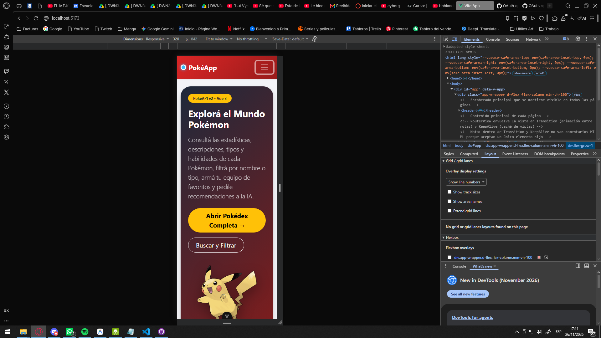
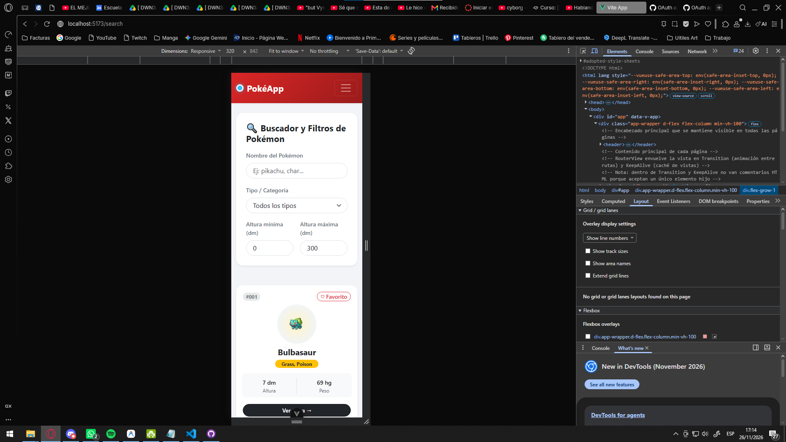
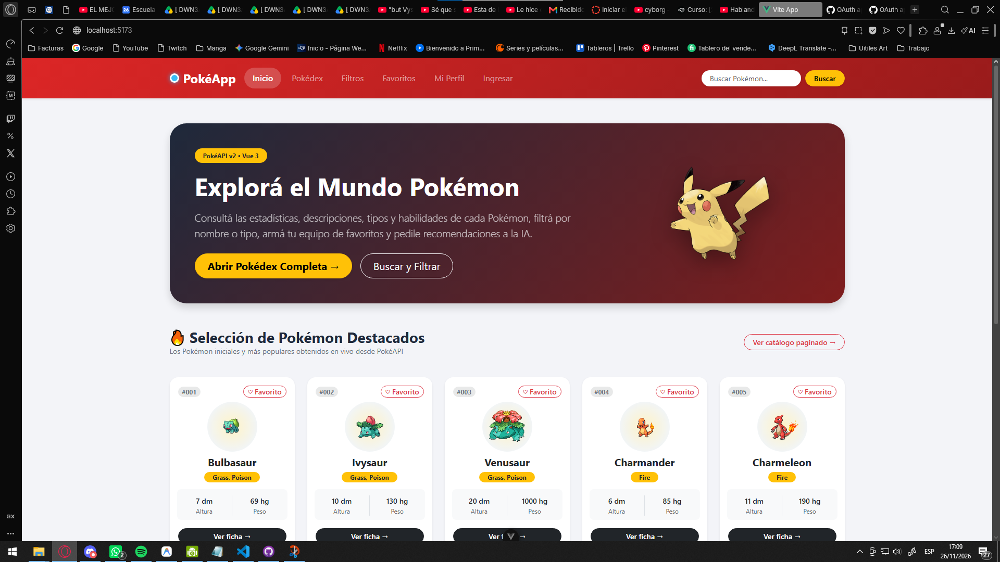
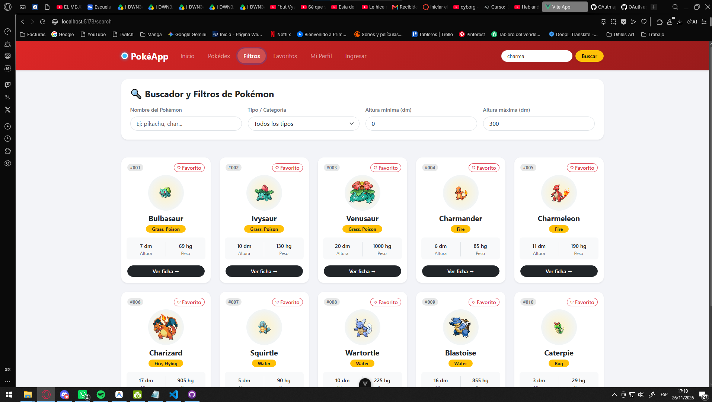

# PokéApp — Trabajo Práctico Segundo Parcial (Vue.js 3 + Vite)

Aplicación web desarrollada con **Vue.js 3** y **Vite** que consume datos en tiempo real desde **PokéAPI**, permitiendo explorar Pokémon, buscar por nombre, filtrar por tipo/categoría y rango de altura, consultar su ficha de detalle con descripción oficial en español, gestionar favoritos con persistencia en `localStorage` y utilizar un asistente recomendador impulsado por **Inteligencia Artificial (Gemini con Firebase AI Logic)**.

---

## 👥 Integrantes

- **Alumna:** Sol Monti

---

## 🎯 Tema y API Elegidos

- **Tema:** Pokédex / Mundo Pokémon.
- **API Pública:** [PokéAPI v2](https://pokeapi.co/) (`https://pokeapi.co/api/v2/`).
- **Endpoints utilizados:**
  - `GET https://pokeapi.co/api/v2/pokemon?limit=10&offset=0`: Obtiene el listado paginado de Pokémon y la selección destacada en la página de inicio (`/`).
  - `GET https://pokeapi.co/api/v2/pokemon/:id`: Obtiene el detalle completo de un Pokémon (sprites/artwork oficial, tipos, altura, peso, experiencia base, habilidades y estadísticas base).
  - `GET https://pokeapi.co/api/v2/pokemon-species/:id`: Obtiene la descripción oficial en español (`flavor_text_entries`) y la categoría de especie (`genera`).
  - `GET https://pokeapi.co/api/v2/type/:tipo`: Obtiene los Pokémon agrupados por categoría/tipo (`fire`, `water`, `grass`, `electric`, etc.) para armar el filtro.
- **Aclaración sobre la búsqueda y el filtrado:** Dado que PokéAPI no ofrece búsqueda parcial por subcadena en el endpoint general, el buscador obtiene el índice de nombres/tipos y aplica una propiedad `computed` en Vue para filtrar reactivamente por nombre, categoría/tipo y rango de altura sobre los datos cargados, manteniendo los parámetros sincronizados en la URL mediante `query params` (`?search=...&tipo=...&min=...&max=...`).

---

## 🚀 Instrucciones para Instalar y Correr el Proyecto

### 1. Clonar el repositorio
```bash
git clone https://github.com/sol-monti-42/vue_2_Sol_Monti.git
cd vue_2_Sol_Monti
```

### 2. Instalar las dependencias
```bash
npm install
```
*(También compatible con `pnpm install`)*

### 3. Correr el servidor de desarrollo
```bash
npm run dev
```
La aplicación estará disponible en `http://localhost:5173/`.

### 4. Compilar para producción
```bash
npm run build
```

---

## ⚙️ Configuración de Firebase y Variables de Entorno

El proyecto utiliza **Firebase** ([src/services/firebase.js](src/services/firebase.js)) en el **Plan Spark (gratuito)** para:
1. **Firebase AI Logic (`firebase/ai`)**: La API key de Gemini **no se incluye en el código**, ya que es administrada directamente por el backend de Firebase (`GoogleAIBackend`).
2. **Firebase Authentication**: Inicio de sesión opcional con Google y GitHub.
3. **Firebase Hosting**: Configurado mediante [firebase.json](firebase.json) con reglas `rewrites` hacia `/index.html` para que todas las rutas de Vue Router (`/detalle/:id`, `/favoritos`, `/search`, `/personajes`) funcionen al recargar la página.

Si se desea usar un proyecto propio de Firebase con variables de entorno, se puede crear un archivo `.env` en la raíz con:
```env
VITE_FIREBASE_API_KEY=tu_api_key
VITE_FIREBASE_AUTH_DOMAIN=tu_proyecto.firebaseapp.com
VITE_FIREBASE_PROJECT_ID=tu_proyecto_id
VITE_FIREBASE_STORAGE_BUCKET=tu_proyecto.firebasestorage.app
VITE_FIREBASE_MESSAGING_SENDER_ID=tu_sender_id
VITE_FIREBASE_APP_ID=tu_app_id
```

---

## 🌐 URL Pública de Firebase Hosting

- **URL de producción:** [https://tp2-pokeapp-sol.web.app](https://tp2-pokeapp-sol.web.app)

---

## 🤖 Opción de Inteligencia Artificial Elegida

- **Tecnología:** **Gemini con Firebase AI Logic** (`firebase/ai` — modelo `gemini-3.5-flash-lite` con `GoogleAIBackend`).
- **Funcionamiento:** En la vista de catálogo ([src/views/RecomendadorView.vue](src/views/RecomendadorView.vue) y [src/services/recomendador.js](src/services/recomendador.js)), el usuario puede escribir un pedido en texto libre (por ejemplo: *"¿Qué Pokémon de tipo fuego o planta me recomendás de esta lista?"*). El asistente recibe como contexto únicamente los Pokémon que la aplicación ya cargó en pantalla y responde una recomendación breve en texto plano sin inventar elementos.
- **Manejo de límites de cuota (Plan Spark):** Si se alcanza el límite de peticiones por minuto del plan gratuito (`429 / RESOURCE_EXHAUSTED`), la interfaz captura el error y muestra un aviso claro al usuario indicando que se alcanzó la cuota gratuita y que intente nuevamente en unos segundos.

---

## 📱🖥️ Capturas de Pantalla

### Versión Móvil (375 px — Mobile First)



### Versión de Escritorio


